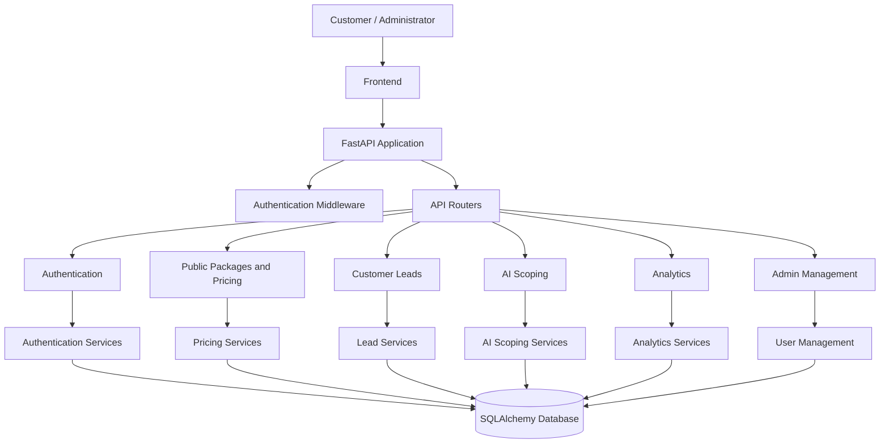
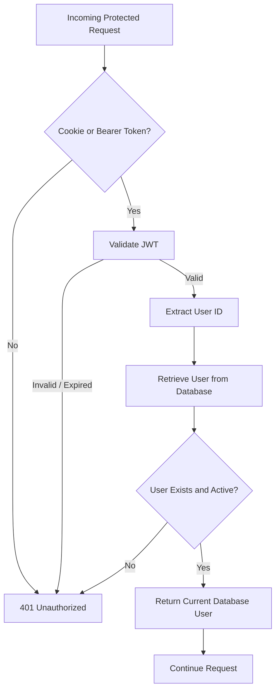

# AgencyForge — System Architecture

## 1. Project Overview

AgencyForge is a FastAPI-based platform designed to address the website development bottleneck faced by small businesses.

The application brings together:

- Customer inquiry collection
- Website development package management
- Project pricing estimation
- AI-assisted project scoping
- Customer lead management
- Business analytics
- User authentication and administrator management

The backend follows a modular architecture that separates HTTP routing, business logic, database models, validation and security.

---

## 2. Technology Architecture

| Layer | Technology |
|---|---|
| Backend framework | FastAPI |
| Programming language | Python |
| ORM | SQLAlchemy 2.x |
| Validation | Pydantic v2 |
| Authentication | JWT |
| Password hashing | Scrypt |
| Database | SQLite / PostgreSQL |
| Frontend rendering | Jinja2 |
| API documentation | OpenAPI / Swagger |
| AI integration | OpenAI-compatible API |
| Testing | Pytest |

---

## 3. High-Level Architecture



The application uses a centralized FastAPI entry point in `main.py`.

Business operations are delegated to services rather than being implemented directly inside route handlers.

---

## 4. Repository Structure

```text
project-root/
│
├── config/
│   └── settings.py
│
├── database/
│   └── database.py
│
├── middleware/
│   ├── auth_middleware.py
│   ├── error_handlers.py
│   └── rate_limiter.py
│
├── models/
│   ├── user.py
│   ├── package.py
│   ├── lead.py
│   └── ai_session.py
│
├── schemas/
│   ├── user.py
│   ├── package.py
│   ├── lead.py
│   ├── analytics.py
│   └── scoping.py
│
├── routes/
│   ├── auth.py
│   ├── admin.py
│   ├── public.py
│   ├── leads.py
│   ├── analytics.py
│   └── scoping.py
│
├── services/
│   ├── auth_service.py
│   ├── lead_service.py
│   ├── pricing_service.py
│   ├── analytics_service.py
│   └── ai_scoping_service.py
│
├── scripts/
│
├── static/
│
├── templates/
│
├── tests/
│
├── utils/
│   ├── security.py
│   └── validators.py
│
├── create_admin.py
├── main.py
├── README.md
└── ARCHITECTURE.md
```

---

## 5. Application Initialization

The application starts through `main.py`.

The initialization process:

1. Creates the FastAPI application.
2. Registers the rate-limit and request-size middleware.
3. Registers global exception handlers.
4. Includes the authentication router.
5. Includes the public router.
6. Includes the AI scoping router.
7. Includes the lead router.
8. Includes the analytics router.
9. Includes the administrator user-management router.
10. Mounts static files and configures Jinja2 templates.
11. On startup, validates runtime settings and confirms the database has the latest Alembic revision.
12. Opens and checks the configured Redis connection when shared rate limits are enabled; closes it on shutdown.

`/health` is a liveness endpoint. `/ready` checks the current database schema
and, when configured, Redis connectivity before reporting readiness.

Startup does not create or migrate tables. Fresh databases are initialized with `alembic upgrade head`; an unmigrated or stale schema prevents the service from starting.

The administrator router is implemented in `routes/admin.py` and included by `main.py`.

---

## 6. Authentication Architecture

### 6.1 Registration

Public registration creates accounts with the `staff` role.

The registration process:

1. Receives registration information.
2. Validates user input.
3. Normalizes the email address.
4. Checks for an existing account.
5. Hashes the password using scrypt.
6. Creates the database record with the staff role.
7. Generates an authentication token.
8. Sets an HttpOnly session cookie.

Public registration never assigns the administrator role.

### 6.2 Login

The login process:

1. Receives email and password.
2. Retrieves the user from the database.
3. Verifies the password against its stored scrypt hash.
4. Rejects incorrect credentials and inactive accounts.
5. Generates a JWT for a valid account.
6. Returns the user information and sets the session cookie.

### 6.3 Authentication Flow



### 6.4 Database-Backed Administrator Authorization

The shared dependency is:

`get_current_admin_user`

It is implemented in:

`middleware/auth_middleware.py`

It first resolves the authenticated user from the database and then checks the current database role.

Authorization does not rely solely on the role claim inside the JWT.

Expected authorization behavior:

| Situation | Result |
|---|---|
| Active administrator | Allowed |
| Active staff account | 403 Forbidden |
| Inactive administrator | 401 Unauthorized |
| Invalid token | 401 Unauthorized |
| Missing credentials | 401 Unauthorized |

### 6.5 Logout

Logout removes the authentication cookie from the browser.

The current implementation does not maintain a server-side JWT revocation list. A copied token remains valid until it expires unless the associated account is deactivated.

---

## 7. Password and Token Security

Security functionality is centralized in:

`utils/security.py`

Password hashing uses Python's scrypt implementation with:

- Random salts
- Configurable scrypt parameters
- Derived password hashes
- Constant-time hash comparison

Password length requirements:

- Minimum: 10 characters
- Maximum: 128 characters

JWT tokens include:

- User ID
- Role claim
- Issued-at timestamp
- Expiration timestamp
- Issuer
- Audience
- Unique token identifier

The JWT signing secret is provided through environment configuration.

---

## 8. Administrator Creation

The application does not provide public administrator registration.

The initial administrator is created through:

`create_admin.py`

Execution:

```bash
python create_admin.py
```

The script:

1. Verifies that the configured database is already migrated.
2. Requests the administrator's full name.
3. Requests the email address.
4. Requests a hidden password through `getpass`.
5. Validates the password.
6. Checks whether the email already exists.
7. Creates an active administrator account.
8. Commits the database transaction.

Existing accounts are never automatically converted into administrators.

---

## 9. Administrator User Management

Implemented in:

`routes/admin.py`

### Endpoint 1: User Listing

`GET /api/admin/users`

Features:

- Administrator-only access
- Pagination
- Total user count
- Stable ordering
- Safe response fields

The response contains:

- ID
- Full name
- Email
- Role
- Active status
- Creation date

Password hashes are never exposed.

### Endpoint 2: Account Status Management

`PATCH /api/admin/users/{user_id}/status`

Features:

- Administrator-only access
- Activate existing accounts
- Deactivate existing accounts
- Pydantic request validation
- Reject unexpected fields
- Prevent role modification
- Prevent administrators from deactivating their own account
- Database rollback on database errors

---

## 10. Database Architecture

The database layer is managed through:

`database/database.py`

SQLAlchemy provides:

- Database engine configuration
- Declarative model base
- Session management
- Schema verification before serving application requests

SQLite is the default local development database.

PostgreSQL is supported for production deployments.

JSON columns use compatible database types, including PostgreSQL JSONB.

Alembic revisions live under `migrations/`. The initial migration captures the
existing ORM schema without speculative changes. Migration commands require an
explicit target and guard repository databases; startup checks the recorded
revision but never applies DDL. SQLite application connections enable foreign
key enforcement. `ix_leads_created_at_id` supports the bounded newest-first
admin lead query; it was added in a reversible follow-up migration after a
20,000-row SQLite query-plan comparison showed the unindexed sort scanning and
sorting all rows.

### 10.1 User Model

Table: `users`

Responsibilities:

- Account identity
- Email
- Password hash
- User role
- Active status
- Creation timestamp

### 10.2 Package Model

Table: `packages`

Responsibilities:

- Website package names
- Descriptions
- Minimum and maximum prices
- Currency
- Included features
- Active status
- Display ordering

### 10.3 Lead Model

Table: `leads`

Responsibilities:

- Customer contact information
- Business details
- Project description
- Requested pages
- Requested features
- Budget range
- Selected package
- AI-generated scope summary
- Estimated project price
- Lead pipeline status

Lead statuses:

- `new`
- `contacted`
- `qualified`
- `proposal_sent`
- `won`
- `lost`

### 10.4 AI Session Model

Table: `ai_sessions`

Responsibilities:

- Conversation history
- AI provider information
- Model information
- Token usage
- Execution duration
- Fallback usage
- Session status
- Optional associated lead

---

## 11. Pricing Architecture

Implemented in:

`services/pricing_service.py`

Pricing is calculated using a deterministic pricing engine.

The calculation uses:

1. Selected package base price.
2. Number of requested website pages.
3. Additional page charges.
4. Requested features.
5. Features already included in the selected package.
6. Additional feature costs.

Features without a defined price are flagged for manual quotation.

This separates pricing rules from HTTP request handling.

---

## 12. Lead Management Architecture

Implemented through:

- `routes/leads.py`
- `services/lead_service.py`
- `models/lead.py`

The lead workflow supports:

1. Public customer inquiry submission.
2. Package validation.
3. Project information storage.
4. Pricing-related information.
5. Administrator lead listing.
6. Individual lead retrieval.
7. Lead status updates.

Lead creation and management operations are delegated to the lead service.

Administrative lead operations require database-backed administrator authorization.

---

## 13. AI Project Scoping Architecture

Implemented through:

- `routes/scoping.py`
- `services/ai_scoping_service.py`
- `models/ai_session.py`

The AI scoping workflow:

1. Receives project requirements.
2. Creates a new session or retrieves an existing session.
3. Retrieves active website packages.
4. Maintains conversation history.
5. Sends relevant context to an external AI provider.
6. Validates and structures the AI response.
7. Generates a deterministic fallback when the external AI request fails.
8. Stores conversation history and usage information.
9. Returns a structured project scope.

The service records token usage, execution time and whether fallback processing was used.

The AI integration uses an OpenAI-compatible API configured through environment variables.

---

## 14. Analytics Architecture

Implemented through:

- `routes/analytics.py`
- `services/analytics_service.py`
- `schemas/analytics.py`

The analytics endpoint is:

`GET /api/admin/analytics`

It requires administrator authorization.

The analytics service produces:

- Total leads
- Lead status distribution
- Conversion rate
- Won and lost lead counts
- Estimated open pipeline value
- Package performance

Date filters use Bangladesh's Asia/Dhaka timezone.

Pipeline values represent estimated opportunities, not confirmed revenue.

---

## 15. Middleware Architecture

### Authentication Middleware

`middleware/auth_middleware.py`

Responsibilities:

- Extract cookie or Bearer credentials
- Validate authentication tokens
- Resolve the current database user
- Reject inactive accounts
- Enforce administrator authorization

### Error Handling

`middleware/error_handlers.py`

Provides centralized handling for:

- Request validation errors
- HTTP errors
- Unexpected application exceptions

Unexpected server errors are logged internally without exposing exception details to API clients.

### Rate Limiting

`middleware/rate_limiter.py`

Implements fixed-window rate limiting using client IP addresses.

When `RATE_LIMIT_REDIS_URL` is configured, an atomic Redis Lua operation shares fixed-window counts across workers. Production requires the shared URL and fails closed when the service is unavailable. Development can omit Redis and use the in-process limiter. Client IPs come from the socket peer; forwarded headers are not trusted.

`middleware/security_headers.py` adds content-type, framing, referrer, feature-policy, and opener headers. HSTS is added when `ENVIRONMENT=production`; HTTPS termination must be provided by the deployment.

`middleware/csrf_protection.py` rejects cross-origin browser writes and requires
a matching `csrf_token` cookie and `X-CSRF-Token` header for state-changing
requests authenticated by the session cookie. Configure trusted proxy handling
so the ASGI request scheme reflects the public HTTPS origin. A Content Security
Policy is deferred while templates still use inline scripts and styles and
load Google Fonts and Lucide externally.

---

## 16. Configuration Architecture

Centralized configuration:

`config/settings.py`

Environment settings include:

- Application name
- Environment
- JWT signing secret
- Access token expiration
- Access token cookie name
- Rate limit configuration
- Maximum request body size

Database connection configuration is loaded through `database/database.py`.

Sensitive credentials must be stored in environment variables and must not be committed to the repository.

---

## 17. Frontend Integration

The FastAPI application serves static files and Jinja2 templates.

Static assets are mounted under:

`/static`

Templates are loaded from:

`/templates`

Page routes currently include:

- `/`
- `/login`
- `/register`
- `/inquiry`
- `/packages`
- `/dashboard`
- `/admin` (active administrators only)

The frontend communicates with backend API endpoints for authentication, package selection, pricing, inquiries and AI scoping.

The dashboard requires an authenticated user.

---

## 18. Error Handling and API Responses

The application uses appropriate HTTP status codes.

| Status | Meaning |
|---|---|
| 200 | Successful request |
| 201 | Resource created |
| 400 | Invalid operation |
| 401 | Authentication required or invalid |
| 403 | Insufficient permissions |
| 404 | Resource not found |
| 422 | Request validation failed |
| 429 | Rate limit exceeded |
| 503 | Service or database temporarily unavailable |
| 500 | Unexpected server error |

API response schemas are defined using Pydantic.

Sensitive database fields are excluded from public response models.

---

## 19. Testing Architecture

The project uses Pytest.

Testing should cover:

- User registration
- Password hashing and verification
- Login and logout
- JWT validation
- Cookie and Bearer authentication
- Inactive account rejection
- Database-backed administrator authorization
- Administrator user listing
- Pagination
- Account activation and deactivation
- Self-deactivation prevention
- Public package listing
- Pricing calculations
- Customer lead workflows
- AI scoping and fallback behavior
- Analytics date filtering

Run the test suite:

```bash
python -m pytest -q
```

---

## 20. Production Considerations

Before production deployment, the following should be addressed:

1. Supply a strong, unique JWT signing secret and `RATE_LIMIT_REDIS_URL`.
2. Enable HTTPS and secure cookies at the deployment edge.
3. Use PostgreSQL or another managed production database.
4. Run and verify Alembic migrations as a separate release operation.
5. Configure trusted proxy handling only for known proxy addresses.
6. Review AI provider credentials and request limits.
7. Configure production logging, monitoring, and alerting.
8. Establish automated backups and tested recovery procedures.
9. Test authentication and authorization behavior under production configuration.

The repository includes GitHub Actions quality checks but no container image,
deployment manifest, production monitoring integration, or live Redis service.

---

## 21. Architectural Design Principles

AgencyForge follows these principles:

- Separation of concerns
- Centralized authentication and authorization
- Database-backed permission checks
- Reusable business services
- Request and response validation
- Explicit error handling
- Least-privilege account registration
- Safe handling of sensitive information
- Modular development across backend, database, AI and frontend components

The architecture is intended to support continued development without tightly coupling individual application modules.
